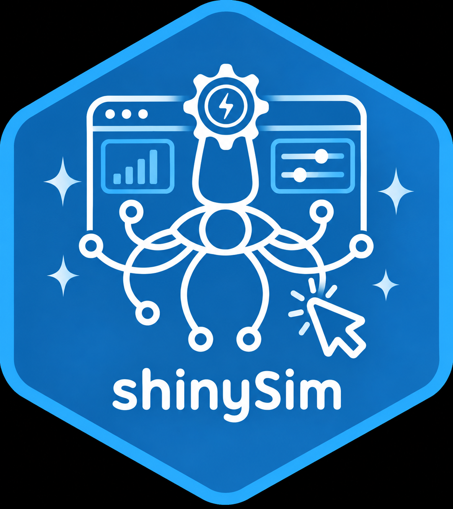

<p align="center">
  
</p>

<div align="center">
 <h1>shinySim</h1>
</div>

<!-- badges: start -->
[](LICENSE.md)
<!-- badges: end -->

shinySim is a **point-and-click interface to the
[squidSim](https://github.com/squidgroup/squidSim) package**. It lets you build
structured simulations — predictors and variance components across the levels
of a hierarchical data structure — without writing the simulation call by hand.

## Features

- **Start from your data structure.** Pass in a structure made with
  `squidSim::make_structure()` (or any data frame of grouping factors) and build
  the simulation on its levels.
- **Set variance components per level.** Add random effects, predictors, fixed
  (categorical) effects, covariates and interactions, with their betas, means and
  (co)variances.
- **See the equations as you go.** The app writes out the model being simulated,
  so what you are building stays legible.
- **See the expected variance decomposition.** The app calculates the expected
  mean and variance of the response, and how the variance divides among
  hierarchical levels and predictors. This includes the covariances that fixed
  effects, interactions and covariates create. Each time you add or update a
  component, the app also runs a quick squidSim simulation and warns you if its
  mean or variance differs from the expected values by more than 10%.
- **Get the code back.** The equivalent `squidSim` call is shown as code you can copy, so simulations remain reproducible outside the app. Run it with `squidSim::simulate_population()` to generate the data.
- **Runs locally.** Nothing is uploaded anywhere.

## Installation

shinySim is not on CRAN, but you can install the development version from GitHub
using the devtools package:

```r
install.packages("devtools")
devtools::install_github("squidgroup/shinySim")
library(shinySim)
```

This will also install [squidSim](https://github.com/squidgroup/squidSim), which
is not on CRAN and is declared via `Remotes:`.

## Usage

The only function is `shinySim()`. It can be run without any arguments:

```r
library(shinySim)
shinySim()
```

Or you can provide a data structure created in `squidSim` (or elsewhere):

```r
library(shinySim)

data_test <- squidSim::make_structure(
  "sex(2)/individual(10)",
  repeat_obs  = 2,
  level_names = list(sex = c("F", "M"))
)

shinySim(data.struc = data_test)
```

## Arguments

| Argument | Purpose |
| :------- | :------ |
| `data.struc` | A data structure created with `squidSim::make_structure()` or an equivalent data frame. Optional — without one, only observation-level predictors and interactions can be added. |

## Bug reports and contributions

Please file issues and feature requests at
<https://github.com/squidgroup/shinySim/issues>. Pull requests are welcome.

Issues with the underlying simulation engine belong upstream at
[squidgroup/squidSim](https://github.com/squidgroup/squidSim).

## Related

- [**squidSim**](https://github.com/squidgroup/squidSim) — the simulation engine
  this app drives
- [**SQuID**](https://squidgroup.org/) — the Statistical Quantification of
  Individual Differences group

## Citation

Please cite the package:

> Ivimey-Cook, E. R., & Pick, J. L. (2026). *shinySim: Shiny interface to the
> squidSim simulation package.* R package version 0.0.0.9000.
> <https://github.com/squidgroup/shinySim>

A machine-readable [`CITATION.cff`](CITATION.cff) is included, so GitHub's
"Cite this repository" button gives formatted APA and BibTeX.

## Contact

Edward R. Ivimey-Cook — <e.ivimeycook@gmail.com> —
[ORCID 0000-0003-4910-0443](https://orcid.org/0000-0003-4910-0443)

## License

Released under the [MIT License](LICENSE.md).
